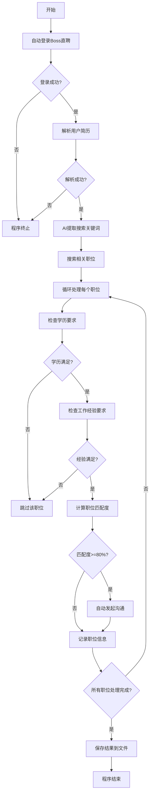

# auto_boss_qichacha
自动登录Boss直聘，根据简历智能匹配职位，并自动发起沟通

## 项目介绍

auto_boss_qichacha 是一个自动化招聘工具，能够帮助求职者：
- 自动登录Boss直聘
- 解析简历并提取关键信息
- 使用AI生成搜索关键词
- 搜索相关职位并计算匹配度
- 自动与高匹配度职位发起沟通
- 保存所有职位信息和匹配结果

## 实际文件结构

```
auto_boss_qichacha/
├── config/              # 配置文件目录
│   └── login_info.json  # 登录信息配置
├── data/                # 数据存储目录
│   ├── img/            # 图片资源
│   ├── jianli/         # 简历文件存放
│   └── jobs/           # 职位结果存放
├── logs/               # 日志文件
│   └── boss_zhipin.log
├── modules/            # 核心功能模块
│   ├── ai_keyword_extractor.py  # AI关键词提取器
│   ├── boss_zhipin.py           # Boss直聘爬虫
│   ├── job_matcher.py           # 职位匹配器
│   └── resume_parser.py         # 简历解析器
├── test/               # 测试文件
├── .env                # 环境变量配置
├── main.py             # 主程序入口
├── pyproject.toml      # 项目配置
└── README.md           # 项目说明
```

## 核心功能模块

### modules/
- **ai_keyword_extractor.py**: 使用大模型从简历中提取搜索关键词
- **boss_zhipin.py**: Boss直聘网站数据获取，包括登录、搜索职位、提取职位详情和自动沟通
- **job_matcher.py**: 计算简历与职位的匹配度
- **resume_parser.py**: 解析PDF简历，提取关键信息（教育经历、工作经验、技能等）

### data/
- **jianli/**: 存放用户简历文件（支持PDF格式）
- **jobs/**: 存放搜索到的职位信息和匹配结果（JSON格式）

## 工作流程



## 安装与配置

### 1. 克隆仓库

```bash
git clone https://github.com/yourusername/auto_boss_qichacha.git
cd auto_boss_qichacha
```

### 2. 使用UV配置环境

UV是一个高性能的Python包管理器，支持虚拟环境管理。我们推荐使用UV来配置项目环境：

#### 2.1 安装UV（如果尚未安装）

```bash
pip install uv
```

或使用官方安装脚本：

```bash
# Linux/macOS
curl -LsSf https://astral.sh/uv/install.sh | sh

# Windows (PowerShell)
irm https://astral.sh/uv/install.ps1 | iex
```

#### 2.2 配置环境

使用UV自动安装所有依赖并创建虚拟环境：

```bash
uv sync
```

UV会自动读取`pyproject.toml`文件中的依赖配置，并创建一个`.venv`目录作为虚拟环境。

### 3. 配置环境变量

编辑 `.env` 文件，配置大模型API密钥：

```
# 大模型名称
MODEL_NAME="qwen3-next-80b-a3b-instruct"

# 大模型API密钥
API_KEY="your_api_key_here"
```

### 4. 放置简历

将你的PDF简历文件放入 `data/jianli/` 目录下。

**注意**: 默认简历路径为 `data/jianli/李阳旭-AI应用开发工程师-1年.pdf`，如果你的简历文件名不同，需要修改 `main.py` 中的简历路径：

```python
# 在main.py中修改简历路径
resume_path = os.path.join(os.path.dirname(__file__), 'data', 'jianli', 'your_resume_filename.pdf')
```

## 使用方法

### 1. 运行主程序

使用UV运行程序（推荐）：

```bash
uv run python main.py
```

或在虚拟环境中运行：

```bash
# 激活虚拟环境
# Linux/macOS
. .venv/bin/activate

# Windows (PowerShell)
.venv\Scripts\Activate.ps1

# 运行程序
python main.py
```

### 2. 程序执行流程

1. **登录Boss直聘**: 程序会自动打开浏览器，你需要手动完成登录（支持账号密码登录或扫码登录）
2. **解析简历**: 程序会解析你放在 `data/jianli/` 目录下的简历
3. **生成关键词**: 使用AI从简历中提取搜索关键词
4. **搜索职位**: 根据关键词搜索相关职位
5. **匹配职位**: 检查每个职位的学历和工作经验要求，计算匹配度
6. **自动沟通**: 对于匹配度>=80%的职位，自动点击"立即沟通"
7. **保存结果**: 将所有职位信息和匹配结果保存到 `data/jobs/` 目录下

### 3. 结果文件

程序执行完成后，会在 `data/jobs/` 目录下生成两个文件：

- **boss_zhipin_jobs_with_match.json**: 包含所有职位的详细信息和匹配结果
- **job_match_stats.json**: 包含职位匹配统计信息（总数、自动沟通数、匹配度分布等）

## 配置说明

### 修改搜索城市

在 `main.py` 中修改搜索城市：

```python
# 搜索城市，默认为"北京"
jobs = boss_client.search_jobs(keyword, city="上海", page=1)
```

### 修改处理职位数量

在 `main.py` 中修改每个关键词处理的职位数量：

```python
# 每个关键词最多处理的职位数，默认为2
max_jobs = min(10, len(jobs))  # 修改为10个职位
```

### 修改匹配度阈值

在 `boss_zhipin.py` 中修改自动沟通的匹配度阈值：

```python
# 匹配度阈值，默认为80%
if match_score >= 80:
    # 自动沟通逻辑
```

## 注意事项

1. **使用频率**: 请勿频繁运行程序，避免被Boss直聘网站限制
2. **登录安全**: 程序不会保存你的登录凭证，请放心使用
3. **手动干预**: 首次运行时需要手动完成登录
4. **浏览器**: 程序使用Chrome浏览器，请确保已安装最新版本
5. **API费用**: 使用AI关键词提取功能会产生API调用费用，请确保你的API密钥有足够余额
6. **UV环境**: 如果使用UV管理环境，请确保UV版本不低于1.0.0
7. **依赖更新**: 如需更新依赖，可以使用 `uv sync --upgrade` 命令
8. **虚拟环境**: UV会自动创建 `.venv` 目录作为虚拟环境，请勿手动删除该目录

## 许可证

MIT License

